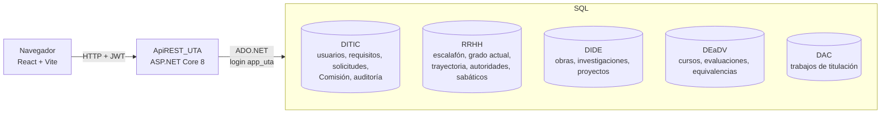
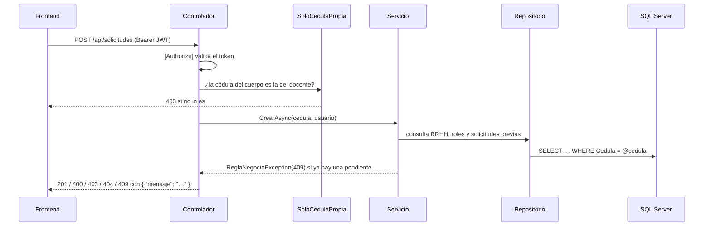

# Arquitectura

## Visión general

El sistema reúne en un solo expediente la información que cada dirección de la UTA guarda en su propia base de datos, calcula un dictamen con cada requisito del CES y de la UTA y gestiona el trámite completo de la promoción: revisión documental, votación de la Comisión Académica, acto administrativo, ejecución y apelación.



| Pieza | Tecnología | Carpeta |
|-------|-----------|---------|
| Frontend | React 18, TypeScript, Vite 5 | `frontend/` |
| API | ASP.NET Core 8, ADO.NET (`Microsoft.Data.SqlClient`), JWT, BCrypt, Swashbuckle | `ApiREST_UTA/` |
| Base de datos | SQL Server 2022 (imagen Developer) | `database/` |
| Orquestación local | Docker Compose | `docker-compose.yml`, `docker/` |
| Pruebas | xUnit + Moq, Vitest + Testing Library, script de punta a punta, k6, OWASP ZAP | `tests/`, `frontend/src/**/*.test.*` |

Solo DITIC es una base **propia del sistema**. Las otras cuatro representan sistemas de otras direcciones y la API **solo las lee**.

## Capas de la API

La API sigue una organización por capas inspirada en Clean Architecture:

```
ApiREST_UTA/
├── API/
│   ├── Controllers/      Endpoints HTTP (Auth, Comision, Evidencias, Importacion, Operacion, Promocion, Requisitos, Roles, Solicitudes, Usuarios)
│   └── Filters/          SoloCedulaPropiaAttribute (un docente solo accede a su cédula) y AuditoriaFilter (bitácora)
├── Application/
│   ├── DTOs/             Formas de las peticiones y respuestas JSON
│   └── Services/         Casos de uso (Solicitud, Comision, Evidencia, Requisito, Usuario, Auth…)
│       └── Promocion/    Motor de reglas: ContextoPromocion, ReglasPromocion (R1-R8), MotorPromocion
├── Domain/
│   ├── Entities/         Modelos y reglas propias de cada dato (Obra.EvaluarRelevancia, Apelacion.PlazoHasta…)
│   └── Interfaces/       Contratos de los repositorios
├── Infrastructure/
│   ├── Repositories/     Acceso a SQL Server con consultas parametrizadas
│   ├── Documentos/       Generador del acto administrativo en PDF
│   └── Salud/            Health check de las cinco bases
└── Program.cs            Configuración: .env, cadenas de conexión, JWT, CORS, Swagger, inyección de dependencias
```

### Flujo de una petición



Los servicios lanzan `ReglaNegocioException` con el código HTTP que corresponde; los controladores de solicitudes y usuarios la convierten en una respuesta `{ "mensaje": "…" }`.

## Configuración

`Program.cs` carga primero el archivo `.env` de la raíz con [DotNetEnv](https://github.com/tonerdo/dotnet-env) **sin pisar** variables que ya existan (por ejemplo, las que define Docker Compose). Con esas variables:

- arma las 5 cadenas de conexión a partir de `DB_HOST`, `DB_PORT`/`SQL_PORT`, `APP_DB_USER` y `APP_DB_PASSWORD`;
- toma la clave de firma de `JWT_KEY` (mínimo 32 caracteres; si falta, la API no arranca);
- configura CORS con `CORS_ORIGINS`;
- habilita Swagger en `Development` o con `SWAGGER_ENABLED=true`;
- limita los intentos de login por IP con `LOGIN_RATE_LIMIT`.

`appsettings.json` no contiene secretos.

## Motor de reglas del dictamen

`PromocionService` arma un `ContextoPromocion` con todo el expediente (las cinco bases y la versión de requisitos que rige) y `MotorPromocion` le aplica las reglas en orden. Cada regla es una clase independiente que devuelve un `ResultadoRequisito` con su código, el artículo que la exige, lo obtenido, lo requerido, si hubo una excepción y un detalle. El servicio no decide nada por su cuenta: la solicitud y el acto usan el mismo dictamen que ve el docente.

| Regla | Artículo |
|-------|----------|
| R1 Grado con promoción | CES art. 76 |
| R2 Permanencia | CES arts. 63, 76 a y 77 a; UTA transitoria quinta |
| R3 Obras de relevancia | CES arts. 76 b, 77 f y 78-87 |
| R4 Evaluación de desempeño | CES arts. 76 c y 77 f |
| R5 Capacitación | CES arts. 76 d y 77 e-i |
| R6 Proyectos | UTA art. 48 e.1 |
| R7 Dirección de proyectos | UTA art. 48 e.2 |
| R8 Trabajos de titulación | UTA art. 48 e.3; CES arts. 36 y 77 j |

Para agregar un requisito se crea una clase de regla, se registra en el motor y se agregan sus pruebas con el artículo en el nombre. Los valores (cuántas obras, cuántas horas…) no están en el código: vienen de `DITIC.RequisitosPromocion`.

## Decisiones de diseño

| Decisión | Motivo |
|----------|--------|
| ADO.NET con SQL a mano en lugar de EF Core | Así estaba construida la API; las bases de otras direcciones no son nuestras y no se migran. EF Core sigue referenciado pero no se usa. |
| Un login de base de datos con permisos mínimos | La API lee las 5 bases y solo escribe en DITIC, sin `DELETE`. |
| JWT de 8 horas con comprobación de usuario activo en cada petición | Simple para una SPA y permite revocar el acceso de inmediato (ver [seguridad](seguridad.md)). |
| Requisitos en una tabla versionada y no en el código | La UTA aún no expide su normativa interna y cada solicitud se evalúa con la versión vigente al presentarla (CES, transitoria novena). |
| La Comisión es una membresía, no un rol | Sus integrantes ya tienen otro rol y cambian con cada periodo. |
| PDF del acto generado por un componente propio | Es un documento de texto; evita una dependencia y se valida su estructura en las pruebas. |
| La autorización por cédula vive en un filtro | `[SoloCedulaPropia]` revisa la propiedad `Cedula` de cualquier cuerpo de petición, así no se repite la comprobación en cada endpoint. |
| El frontend usa rutas por hash (`#/solicitudes/3`) | No necesita configuración de servidor y el botón "atrás" funciona igual en Vite y en nginx. |
| El catálogo de roles es público | Es información del reglamento y la pantalla de login lo usa para dibujar el escalafón. |
