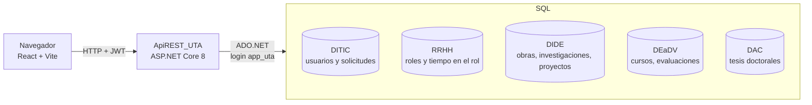
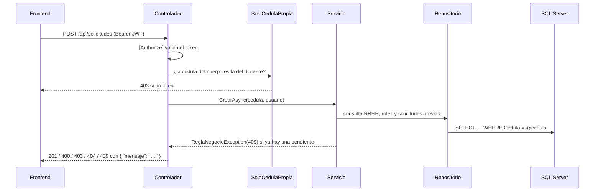

# Arquitectura

## Visión general

El sistema reúne en un solo expediente la información que cada dirección de la UTA guarda en su propia base de datos, calcula si el docente cumple los requisitos para el siguiente rol del escalafón y gestiona la aprobación de la promoción.



| Pieza | Tecnología | Carpeta |
|-------|-----------|---------|
| Frontend | React 18, TypeScript, Vite 5 | `frontend/` |
| API | ASP.NET Core 8, ADO.NET (`Microsoft.Data.SqlClient`), JWT, BCrypt, Swashbuckle | `ApiREST_UTA/` |
| Base de datos | SQL Server 2022 (imagen Developer) | `database/` |
| Orquestación local | Docker Compose | `docker-compose.yml`, `docker/` |
| Pruebas | xUnit + Moq, Vitest + Testing Library, script de punta a punta | `tests/`, `frontend/src/**/*.test.*` |

Solo DITIC es una base **propia del sistema** (usuarios, solicitudes y revisiones). Las otras cuatro representan sistemas de otras direcciones y la API **solo las lee**.

## Capas de la API

La API sigue una organización por capas inspirada en Clean Architecture:

```
ApiREST_UTA/
├── API/
│   ├── Controllers/      Endpoints HTTP (Auth, Importacion, Promocion, Roles, Solicitudes, Usuarios)
│   └── Filters/          SoloCedulaPropiaAttribute: un docente solo accede a su cédula
├── Application/
│   ├── DTOs/             Formas de las peticiones y respuestas JSON
│   └── Services/         Reglas de negocio (PromocionService, SolicitudService, UsuarioService, AuthService)
├── Domain/
│   ├── Entities/         Modelos (Usuario, Rol, SolicitudPromocion, RevisionDocumento…)
│   └── Interfaces/       Contratos de los repositorios
├── Infrastructure/
│   └── Repositories/     Acceso a SQL Server con consultas parametrizadas
└── Program.cs            Configuración: .env, cadenas de conexión, JWT, CORS, Swagger, inyección de dependencias
```

### Flujo de una petición



Los servicios lanzan `ReglaNegocioException` con el código HTTP que corresponde; los controladores de solicitudes y usuarios la convierten en una respuesta `{ "mensaje": "…" }`.

## Configuración

`Program.cs` carga primero el archivo `.env` de la raíz con [DotNetEnv](https://github.com/tonerdo/dotnet-env) **sin pisar** variables que ya existan (por ejemplo, las que define Docker Compose). Con esas variables:

- arma las 5 cadenas de conexión a partir de `DB_HOST`, `DB_PORT`/`SQL_PORT`, `APP_DB_USER` y `APP_DB_PASSWORD`;
- toma la clave de firma de `JWT_KEY` (mínimo 32 caracteres; si falta, la API no arranca);
- configura CORS con `CORS_ORIGINS`;
- habilita Swagger en `Development` o con `SWAGGER_ENABLED=true`.

`appsettings.json` no contiene secretos.

## Decisiones de diseño

| Decisión | Motivo |
|----------|--------|
| ADO.NET con SQL a mano en lugar de EF Core | Así estaba construida la API; las bases de otras direcciones no son nuestras y no se migran. EF Core está referenciado pero no se usa. |
| Un login de base de datos con permisos mínimos | La API lee las 5 bases y solo escribe en `Usuarios`, `SolicitudesPromocion` y `RevisionesDocumento` de DITIC. |
| JWT sin estado, 8 horas de duración | Simple para una SPA. Consecuencia: desactivar un usuario no invalida un token ya emitido (ver [seguridad](seguridad.md)). |
| La autorización por cédula vive en un filtro | `[SoloCedulaPropia]` revisa la propiedad `Cedula` de cualquier cuerpo de petición, así no se repite la comprobación en cada endpoint. |
| El frontend usa rutas por hash (`#/solicitudes/3`) | No necesita configuración de servidor y el botón "atrás" funciona igual en Vite y en nginx. |
| El catálogo de roles es público | Es información del reglamento y la pantalla de login lo usa para dibujar el escalafón. |
