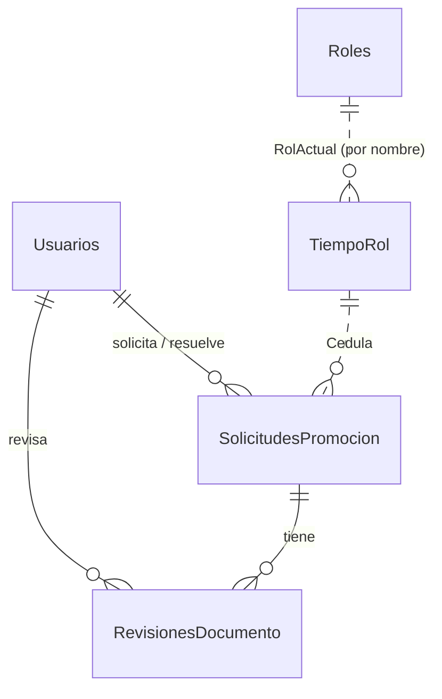

# Base de datos

Un servidor SQL Server 2022 aloja 5 bases. Cada una representa el sistema de una dirección de la UTA.

## Scripts

```
database/
├── schema/      Crea las bases y tablas (00-create-databases.sql … 05-dac.sql)
├── security/    Login de la API con permisos mínimos (usa variables de sqlcmd)
└── seed/        Datos de prueba de desarrollo
docker/init-db.sh   Ejecuta schema → security → seed (si SEED_DATA=true)
```

Todos los scripts son **idempotentes**: crean solo lo que falta y cargan datos de prueba solo si la tabla está vacía. `sqlcmd` se ejecuta con `-I` (`QUOTED_IDENTIFIER ON`), que necesita el índice filtrado de solicitudes.

```bash
docker compose run --rm db-init   # volver a aplicar los scripts
docker compose down -v            # borrar el volumen y empezar de cero
```

## Modelo



Las bases se relacionan **por cédula** (`CHAR(10)`), sin claves foráneas entre bases.

### DITIC (propia del sistema)

| Tabla | Columnas principales | Notas |
|-------|---------------------|-------|
| `Usuarios` | `Id`, `Correo` (único), `Contrasena` (hash BCrypt), `Nombre`, `Apellido`, `Rol` (`Administrador`/`RRHH`/`Docente`), `Cedula`, `Activo`, `FechaCreacion` | |
| `SolicitudesPromocion` | `Id`, `Cedula`, `RolActualId`, `RolActual`, `RolObjetivo`, `Estado` (`Pendiente`/`Aprobada`/`Rechazada`), `SolicitadoPorId`, `FechaSolicitud`, `ResueltoPorId`, `FechaResolucion`, `Observacion` | Índice único filtrado: una sola `Pendiente` por cédula |
| `RevisionesDocumento` | `Id`, `SolicitudId`, `TipoDocumento`, `DocumentoId`, `Estado` (`Aprobado`/`Rechazado`), `Observacion`, `RevisadoPorId`, `FechaRevision` | Único por (`SolicitudId`, `TipoDocumento`, `DocumentoId`) |

### RRHH

| Tabla | Columnas | Notas |
|-------|----------|-------|
| `Roles` | `Id`, `Nombre`, `RequiereAniosEnRol`, `RequiereObras`, `RequiereEvaluacion`, `RequiereCapacitacionHoras`, `RequiereInvestigacionMeses` | El `Id` sigue el orden de la carrera: el siguiente rol es el primer `Id` mayor |
| `TiempoRol` | `Id`, `Cedula` (único), `RolActual`, `FechaInicio`, `Pdf` | `Pdf` = acción de personal |

### DIDE

| Tabla | Columnas |
|-------|----------|
| `Obras` | `Id`, `Cedula`, `Titulo`, `FechaPublicacion`, `NombreRevista`, `Idioma`, `FiliacionUTA`, `Pdf` |
| `Investigaciones` | `Id`, `Cedula`, `Nombre`, `Encargado`, `Horas`, `Pdf` |
| `ParticipacionProyecto` | `Id`, `Cedula`, `NombreProyecto`, `Rol` (`Investigador`/`CoordinadorPrincipal`/`CoordinadorSubrogante`), `MesesParticipacion` |

### DEaDV

| Tabla | Columnas |
|-------|----------|
| `CursosCapacitacion` | `Id`, `Cedula`, `NombreCurso`, `Universidad`, `Facultad`, `FechaEvaluacion`, `Puntaje` |
| `EvaluacionesDocentes` | `Id`, `Cedula`, `Periodo`, `Universidad`, `Carrera`, `Puntaje` (0–100), `Pdf` |
| `CapacitacionImpartida` | `Id`, `Cedula`, `NombreCurso`, `Horas` |

### DAC

| Tabla | Columnas |
|-------|----------|
| `TesisDoctorado` | `Id`, `Cedula`, `Titulo`, `Universidad`, `EsDirigida` |

## Permisos del login de la API

`database/security/01-app-login.sql` crea el login `APP_DB_USER` (contraseña `APP_DB_PASSWORD`):

| Base | Permisos |
|------|----------|
| DITIC, RRHH, DIDE, DEaDV, DAC | `db_datareader` (lectura) |
| DITIC | `INSERT` y `UPDATE` en `Usuarios`, `SolicitudesPromocion` y `RevisionesDocumento` |

La API nunca usa `sa`. No tiene permiso de `DELETE` en ninguna tabla.

## Datos de prueba

Contraseña de todos los usuarios: `Uta2026*`.

| Cédula | Docente | Rol actual | Situación |
|--------|---------|-----------|-----------|
| 1801234567 | Ana María Pérez Villacís | Agregado 1 (desde 2020) | Cumple todo para Agregado 2. Tiene una solicitud pendiente. |
| 1809876543 | Carlos Andrés Gómez Lalama | Auxiliar 2 (desde 2023) | Le faltan tiempo, obras, evaluaciones y capacitación para Agregado 1. |
| 1712345678 | Lucía Fernanda Mora Andrade | Principal 1 (desde 2018) | Cumple todo menos tesis doctoral para Principal 2 (ver [problemas conocidos](problemas-conocidos.md)). |

Los PDF de prueba son documentos mínimos generados en SQL con el texto "Documento de prueba".

Los **requisitos de cada rol en `seed/02-rrhh.sql` son ilustrativos**: deben reemplazarse por los del reglamento oficial de la UTA.
