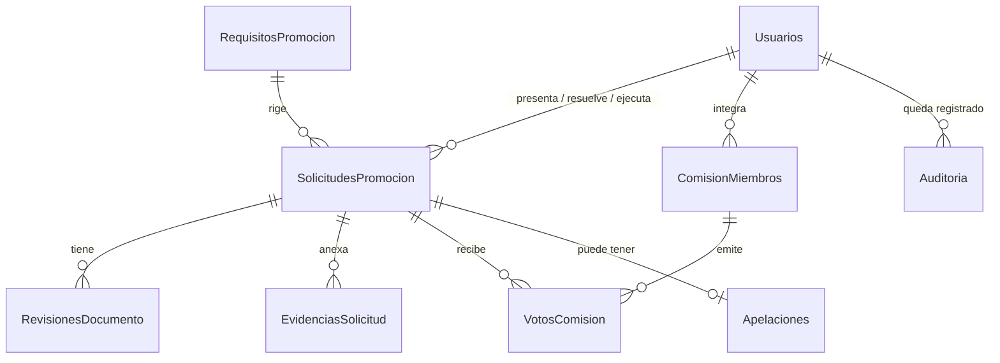

# Base de datos

Un servidor SQL Server 2022 aloja 5 bases. Cada una representa el sistema de una dirección de la UTA. El sistema solo **escribe** en DITIC; las otras cuatro las lee con el contrato descrito en [contrato de datos](contrato-datos-ditic.md).

## Scripts

```
database/
├── schema/      Crea las bases y tablas (00-create-databases.sql … 05-dac.sql)
├── security/    Login de la API con permisos mínimos (usa variables de sqlcmd)
└── seed/        Datos de prueba de desarrollo
docker/init-db.sh     Ejecuta schema → security → seed (si SEED_DATA=true)
docker/backup-db.sh   Respaldo verificado de las 5 bases
docker/restore-db.sh  Restauración desde un respaldo
```

Todos los scripts son **idempotentes**: crean solo lo que falta, migran columnas y restricciones de versiones anteriores (por ejemplo, el estado `Pendiente` pasa a `RevisionDocumental`) y cargan datos de prueba solo si la tabla está vacía. `sqlcmd` se ejecuta con `-I` (`QUOTED_IDENTIFIER ON`), que necesitan los índices filtrados.

```bash
docker compose run --rm db-init   # volver a aplicar los scripts
docker compose down -v            # borrar el volumen y empezar de cero
```

## Modelo de DITIC



Las bases se relacionan **por cédula** (`CHAR(10)`), sin claves foráneas entre bases. `RequisitosPromocion.GradoOrigen` corresponde a `RRHH.dbo.Roles.Id`.

### DITIC (propia del sistema)

| Tabla | Columnas principales | Notas |
|-------|---------------------|-------|
| `Usuarios` | `Id`, `Correo` (único), `Contrasena` (hash BCrypt), `Nombre`, `Apellido`, `Rol` (`Administrador`/`RRHH`/`Autoridad`/`Docente`), `Cedula`, `Activo`, `FechaCreacion` | |
| `RequisitosPromocion` | `GradoOrigen`, `GradoDestino`, `Normativa`, `Resolucion`, `EsPropuesta`, `VigenteDesde`, `VigenteHasta`, `ObrasTotales`, `ObrasEnGrado`, `EvaluacionMinima`, `EvaluacionPeriodos`, `CapacitacionHoras`, `CapacitacionAnios`, `CapacitacionPctPedagogica`, `ProyectosMeses`, `RequiereDireccionProyecto`, `TrabajosTitulacion`, `TitulacionNivelMinimo`, `CreadoPorId` | Versionada: una sola versión abierta (`VigenteHasta` nulo) por grado. `GradoDestino = GradoOrigen + 1` |
| `SolicitudesPromocion` | `Cedula`, `RolActualId`, `RolActual`, `RolObjetivo`, `Estado`, `RequisitosPromocionId`, `DictamenJson`, `FechaEnvioComision`, `NumeroResolucion`, `ActoPdf`, `ActoHash`, `AccionPersonalNumero`, `AccionPersonalFecha`, quién y cuándo en cada paso | `Estado`: `RevisionDocumental`, `EnComision`, `Aprobada`, `Rechazada`, `Apelada`, `Ejecutada`. Índice único filtrado: una sola en trámite (`RevisionDocumental`, `EnComision`, `Apelada`) por cédula |
| `RevisionesDocumento` | `SolicitudId`, `TipoDocumento`, `DocumentoId`, `Estado` (`Aprobado`/`Rechazado`), `Observacion`, `RevisadoPorId`, `FechaRevision` | Única por (`SolicitudId`, `TipoDocumento`, `DocumentoId`) |
| `EvidenciasSolicitud` | `SolicitudId`, `Tipo`, `Descripcion`, `NombreArchivo`, `Contenido` (PDF), `Hash` (SHA-256), `Tamano`, `SubidoPorId`, `FechaSubida` | Solo se insertan: una evidencia no se edita ni se borra |
| `ComisionMiembros` | `UsuarioId`, `Cargo`, `EsPresidente`, `VigenteDesde`, `VigenteHasta` | `Cargo`: `VicerrectorAcademico`, `ProfesorHCU`, `ProfesorTerna`, `DirectorFinanciero`, `DirectorTalentoHumano` |
| `VotosComision` | `SolicitudId`, `MiembroId`, `Voto` (`AFavor`/`EnContra`/`Abstencion`), `Motivacion`, `CertificaPresupuesto`, `Fecha` | Uno por miembro y solicitud; se puede cambiar mientras la votación siga abierta |
| `Apelaciones` | `SolicitudId` (único), `Fundamentos`, `FechaPresentacion`, `PresentadaPorId`, `Estado` (`Pendiente`/`Aceptada`/`Negada`), `ResolucionHCU`, `Motivacion`, `ResueltaPorId`, `FechaResolucion` | Una apelación por solicitud |
| `Auditoria` | `Id` (`BIGINT`), `Fecha`, `UsuarioId`, `Usuario`, `Accion`, `Metodo`, `Ruta`, `Estado`, `Ip`, `Detalle` | Solo se insertan |

### RRHH

| Tabla | Columnas | Notas |
|-------|----------|-------|
| `Roles` | `Id`, `Nombre`, `Categoria`, `Nivel`, `Grado`, `PermanenciaAnios`, `Promocionable` | Escalafón del CES art. 63. Los requisitos de promoción ya no viven aquí sino en `DITIC.RequisitosPromocion` |
| `TiempoRol` | `Id`, `Cedula` (único), `RolActual`, `FechaInicio`, `Pdf` | `Pdf` = acción de personal |
| `TrayectoriaDocente` | `Cedula`, `FechaIngresoInstitucion`, `FechaIngresoTitular`, `MesesNoTitular`, `MesesTecnicoDocente`, `IngresoConPhD` | Para la transitoria quinta del CES |
| `CargosAutoridad` | `Cedula`, `Cargo`, `TipoCargo` (`Rector`/`Vicerrector`/`AutoridadOrganismoSES`/`AutoridadAcademica`), `FechaInicio`, `FechaFin`, `Pdf` | Excepciones del art. 77 f |
| `Sabaticos` | `Cedula`, `FechaInicio`, `FechaFin`, `InformeAprobado` | Art. 77 e |

### DIDE

| Tabla | Columnas |
|-------|----------|
| `Obras` | `Id`, `Cedula`, `Titulo`, `FechaPublicacion`, `NombreRevista`, `Idioma`, `FiliacionUTA`, `TipoObra`, `ISSN`, `ISBN`, `BaseIndexacion`, `RevisionPares`, `RegistroSENADI`, `ValoracionExterna`, `Pdf` |
| `Investigaciones` | `Id`, `Cedula`, `Nombre`, `Encargado`, `Horas`, `Pdf` |
| `ParticipacionProyecto` | `Id`, `Cedula`, `NombreProyecto`, `Rol` (`Director`/`Codirector`/`Participante`), `TipoProyecto` (`Investigacion`/`Vinculacion`), `MesesParticipacion`, `FechaInicio`, `FechaFin` |

### DEaDV

| Tabla | Columnas |
|-------|----------|
| `CursosCapacitacion` | `Id`, `Cedula`, `NombreCurso`, `Universidad`, `Facultad`, `FechaEvaluacion`, `Puntaje`, `Horas`, `TipoCapacitacion` (`Pedagogica`/`Cientifica`/`CongresoInternacional`), `FechaInicio`, `FechaFin` |
| `EvaluacionesDocentes` | `Id`, `Cedula`, `Periodo`, `PeriodoAcademico`, `Universidad`, `Carrera`, `Puntaje` (0–100), `EjercioDocencia`, `Pdf` |
| `Equivalencias` | `Id`, `Cedula`, `Tipo`, `Fecha`, `Meses`, `Descripcion`, `Pdf` (evaluador externo, par evaluador, facilitador CES, par CACES; art. 77 g-i) |
| `CapacitacionImpartida` | `Id`, `Cedula`, `NombreCurso`, `Horas` |

### DAC

| Tabla | Columnas |
|-------|----------|
| `TrabajosTitulacionDirigidos` | `Id`, `Cedula`, `Titulo`, `Nivel` (`Grado`/`Maestria`/`Doctorado`), `Rol` (`Director`/`Codirector`), `FechaAprobacion`, `Universidad`, `Pdf` |

La antigua `TesisDoctorado` se migró a esta tabla y se eliminó.

## Permisos del login de la API

`database/security/01-app-login.sql` crea el login `APP_DB_USER` (contraseña `APP_DB_PASSWORD`):

| Base | Permisos |
|------|----------|
| DITIC, RRHH, DIDE, DEaDV, DAC | `db_datareader` (lectura) |
| DITIC | `INSERT` y `UPDATE` en `Usuarios`, `SolicitudesPromocion`, `RevisionesDocumento`, `RequisitosPromocion`, `ComisionMiembros`, `VotosComision` y `Apelaciones` |
| DITIC | Solo `INSERT` en `EvidenciasSolicitud` y `Auditoria` (no se pueden alterar) |

La API nunca usa `sa`. No tiene permiso de `DELETE` en ninguna tabla.

## Respaldos

Ver [despliegue](despliegue.md#copias-de-seguridad).

## Datos de prueba

Contraseña de todos los usuarios: `Uta2026*`. Las fechas son relativas al día en que se crea la base, para que los escenarios no caduquen.

| Cédula | Docente | Grado actual | Escenario |
|--------|---------|-------------|-----------|
| 1801234567 | Ana María Pérez Villacís | Agregado 1 desde 2020 | Cumple todo para Agregado 2. Tiene una solicitud en revisión documental. |
| 1809876543 | Carlos Andrés Gómez Lalama | Auxiliar 2 desde hace 2 años y medio | No cumple la permanencia: no puede solicitar todavía (CES art. 99). |
| 1712345678 | Lucía Fernanda Mora Andrade | Principal 1 desde 2018 | Cumple para Principal 2. Integra la Comisión: no puede votar su propia solicitud. |
| 1805555555 | Jorge Patricio Ruiz Naranjo | Agregado 3 | No tiene promoción: pasa a Principal por concurso (art. 76). |
| 1701111111 | Marta Cecilia Villacrés Paredes | Agregado 2 desde hace 28 meses | Cumple gracias a las excepciones: experiencia acumulada (transitoria quinta) y cargo de autoridad (art. 77 f). |

| Usuario | Rol | Comisión |
|---------|-----|----------|
| `admin@uta.edu.ec` | Administrador | |
| `rrhh@uta.edu.ec` | RRHH | Director de Talento Humano |
| `vicerrectorado@uta.edu.ec` | Autoridad | Vicerrector Académico, preside |
| `financiero@uta.edu.ec` | Autoridad | Director Financiero |
| `profesor.hcu@uta.edu.ec` | Docente | Profesor designado por el HCU |
| `profesor.terna@uta.edu.ec` | Docente | Profesor de terna |
| `lucia.mora@uta.edu.ec` | Docente | Profesor de terna |

Los PDF de prueba son documentos mínimos generados en SQL con el texto "Documento de prueba".

Los **requisitos de promoción cargados son una propuesta** (`EsPropuesta = 1`) mientras la UTA expide su normativa interna (transitoria cuarta, 0153-HCU-2026). Respetan los mínimos del CES; cuando haya resolución, el Administrador crea una nueva versión en *Requisitos*.
