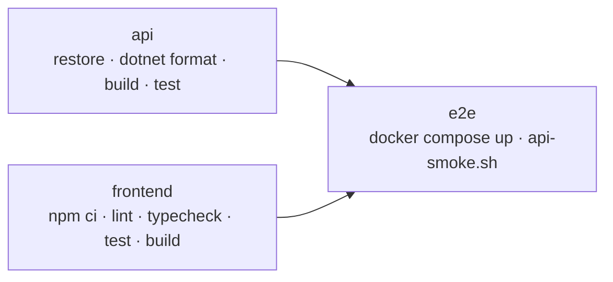

# Pruebas y CI

## Resumen

| Nivel | Herramientas | Ubicación | Cantidad |
|-------|-------------|-----------|---------:|
| Unitarias de la API | xUnit, Moq | `tests/ApiREST_UTA.Tests/` | 46 |
| Unitarias del frontend | Vitest, Testing Library, jsdom | `frontend/src/**/*.test.{ts,tsx}` | 32 |
| Punta a punta | Bash + curl contra Docker Compose | `tests/e2e/api-smoke.sh` | 32 comprobaciones |
| Lint | `dotnet format`, ESLint, TypeScript | — | — |

## API (xUnit)

```bash
dotnet test PromocionDocente.sln
dotnet test PromocionDocente.sln --collect:"XPlat Code Coverage"   # con cobertura (coverlet)
```

Las pruebas usan Moq para reemplazar los repositorios, así que **no necesitan base de datos**.

| Archivo | Qué cubre |
|---------|-----------|
| `AuthServiceTests` | Login con BCrypt, usuario desactivado, claims del token (rol, cédula) |
| `PromocionServiceTests` | Cálculo de cada requisito: años, obras, mínimo de 4 evaluaciones, 20 h = 1 mes de investigación, horas de capacitación |
| `SolicitudServiceTests` | Crear (404, 400, 409 por pendiente o ya aprobada), listar por rol, 403 a docentes ajenos, revisión de documentos y resolución |
| `UsuarioServiceTests` | Validaciones de alta, normalización del correo, hash BCrypt, el administrador no puede bloquearse |
| `ClaimsUsuarioTests` | Quién puede consultar qué cédula |
| `SoloCedulaPropiaAttributeTests` | El filtro responde 403 a un docente con cédula ajena |

`Usuarios.cs` construye el `ClaimsPrincipal` de cada tipo de usuario.

## Frontend (Vitest)

```bash
cd frontend
npm test                 # una vez
npm run test:watch       # modo observador
npm run test:coverage    # con cobertura en frontend/coverage
```

| Archivo | Qué cubre |
|---------|-----------|
| `ruta.test.ts` | Lectura y escritura de rutas por hash |
| `secciones.test.ts` | Qué vistas puede abrir cada rol y dónde aterriza |
| `requisitos.test.ts` | Textos del dictamen, `cumpleTodo`, `plural` |
| `api.test.ts` | Cliente HTTP con `fetch` simulado: mensajes de error, 404 como lista vacía, último rol, 403 |
| `components/Login.test.tsx` | Envío del formulario y mensaje de credenciales inválidas |
| `components/Escalafon.test.tsx` | Orden de los roles, rol actual y siguiente |
| `components/ControlRevision.test.tsx` | Aprobar, rechazar con motivo obligatorio, modo solo lectura y errores |

Las vistas completas (`vistas/*`) no tienen pruebas unitarias propias; la prueba de punta a punta cubre su flujo a través de la API.

## Punta a punta

`tests/e2e/api-smoke.sh` necesita una base **recién creada** porque crea y resuelve solicitudes:

```bash
docker compose down -v
docker compose up -d --build
bash tests/e2e/api-smoke.sh
```

Recorre los tres roles: endpoints públicos y 401, permisos de docente (403 con cédula ajena), solicitud duplicada (409), revisión con motivo obligatorio, imposibilidad de aprobar con documentos rechazados, aprobación final, gestión de usuarios (alta, desactivación, login bloqueado) y que el frontend responda. Variables opcionales: `API_URL`, `FRONTEND_URL`, `CONTRASENA_PRUEBAS`.

## Integración continua (GitHub Actions)

`.github/workflows/ci.yml` se ejecuta en cada push y pull request a `main` y `develop`, y también a mano (`workflow_dispatch`).



| Job | Pasos | Artefactos |
|-----|-------|-----------|
| `api` | `dotnet restore`, `dotnet format --verify-no-changes`, `dotnet build -c Release`, `dotnet test` con cobertura | `resultados-api` (TRX y cobertura) |
| `frontend` | `npm ci`, `npm run lint`, `npm run typecheck`, `npm run test:coverage`, `npm run build` | `cobertura-frontend` |
| `e2e` | Genera un `.env` con secretos aleatorios, levanta el stack y ejecuta `api-smoke.sh`. Si falla, muestra los logs de los contenedores. | — |

Una ejecución nueva en la misma rama cancela la anterior. El workflow solo tiene permiso de lectura sobre el repositorio.

`.github/dependabot.yml` propone actualizaciones semanales de NuGet y npm y mensuales de GitHub Actions e imágenes Docker, todas contra `develop`.

### Antes de abrir un pull request

```bash
dotnet format PromocionDocente.sln --verify-no-changes && dotnet test PromocionDocente.sln
cd frontend && npm run lint && npm run typecheck && npm test && npm run build
```
