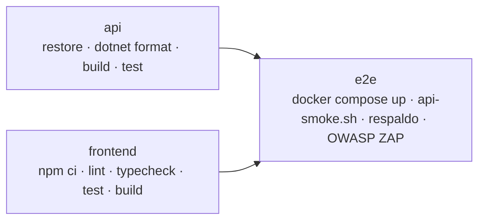

# Pruebas y CI

Qué se prueba y con qué criterio está en el [plan de pruebas](plan-pruebas.md). Este documento explica cómo ejecutar cada nivel.

## Resumen

| Nivel | Herramientas | Ubicación | Cantidad |
|-------|-------------|-----------|---------:|
| Unitarias de la API | xUnit, Moq | `tests/ApiREST_UTA.Tests/` | 125 |
| Unitarias del frontend | Vitest, Testing Library, jsdom | `frontend/src/**/*.test.{ts,tsx}` | 31 |
| Punta a punta | Bash + curl contra Docker Compose | `tests/e2e/api-smoke.sh` | 86 comprobaciones |
| Rendimiento | k6 | `tests/performance/carga.js` | 3 umbrales |
| Seguridad | OWASP ZAP | `.github/workflows/ci.yml` | baseline + API |
| Lint | `dotnet format`, ESLint, TypeScript | — | — |

## API (xUnit)

```bash
dotnet test PromocionDocente.sln
dotnet test PromocionDocente.sln --collect:"XPlat Code Coverage"   # con cobertura (coverlet)
```

Las pruebas usan Moq para reemplazar los repositorios, así que **no necesitan base de datos**. Las que verifican una norma llevan el artículo en el nombre (`Art76c_UsaSoloLasCuatroUltimasEvaluaciones`, `COA224_ElPlazoEsDeDiezDiasHabiles`); la [matriz de cumplimiento](cumplimiento-normativo.md) las enlaza con cada artículo.

| Archivo | Qué cubre |
|---------|-----------|
| `Promocion/ReglasPromocionTests` | Reglas R1 a R8 del dictamen, excepciones del art. 77, transitoria quinta y la alerta de UTA-EV art. 15. `Promocion/Escenario.cs` arma un expediente que cumple todo y cada prueba cambia solo lo que verifica |
| `SolicitudServiceTests` | Presentación, revisión documental, envío a la Comisión, votación (quórum, mayoría, dirimente, presupuesto, conflicto de interés), acto, acción de personal y apelación (plazo en días hábiles) |
| `ComisionServiceTests` | Integración de la Comisión: presidencia, ternas, cargos únicos |
| `EvidenciaServiceTests` | Solo PDF reales de hasta 10 MB, permisos y estado de la solicitud |
| `GeneradorActoTests` | PDF válido (tabla de referencias), contenido del acto y recurso de apelación |
| `AuditoriaFilterTests` | Enmascarado de contraseñas, que las consultas no se registren y que una falla de la bitácora no interrumpa la operación |
| `AuthServiceTests` | Login con BCrypt, usuario desactivado, claims del token y de la Comisión |
| `UsuarioServiceTests` | Validaciones de alta, normalización del correo, hash BCrypt, el administrador no puede bloquearse |
| `ClaimsUsuarioTests` | Quién puede consultar qué cédula |
| `SoloCedulaPropiaAttributeTests` | El filtro responde 403 a un docente con cédula ajena |

`Usuarios.cs` construye el `ClaimsPrincipal` de cada tipo de usuario.

## Frontend (Vitest)

```bash
cd frontend
npm test                 # una vez
npm run test:watch       # modo observador
npm run test:coverage    # con cobertura en frontend/coverage
```

| Archivo | Qué cubre |
|---------|-----------|
| `ruta.test.ts` | Lectura y escritura de rutas por hash |
| `secciones.test.ts` | Qué vistas abre cada rol, con y sin Comisión, y que toda sección visible esté permitida |
| `api.test.ts` | Cliente HTTP con `fetch` simulado: mensajes de error, 404 como lista vacía, dictamen que no se puede calcular, 401 y 403 |
| `components/Login.test.tsx` | Envío del formulario y mensaje de credenciales inválidas |
| `components/Escalafon.test.tsx` | Orden de los grados, grado actual y siguiente |
| `components/ControlRevision.test.tsx` | Aprobar, rechazar con motivo obligatorio, modo solo lectura y errores |

Las vistas completas (`vistas/*`) no tienen pruebas unitarias propias; la prueba de punta a punta cubre su flujo a través de la API y la revisión visual se hace antes de cada versión.

## Punta a punta

`tests/e2e/api-smoke.sh` necesita una base **recién creada** porque crea y resuelve solicitudes. Como inicia sesión con muchos usuarios seguidos, hay que subir el límite de login:

```bash
docker compose down -v
LOGIN_RATE_LIMIT=100 docker compose up -d --build
bash tests/e2e/api-smoke.sh
```

Recorre el trámite completo: dictamen de cada escenario de prueba, solicitudes rechazadas por permanencia o por grado, evidencias PDF, revisión documental, votación con todas sus reglas, acto en PDF, acción de personal, negativa con apelación aceptada por el HCU, requisitos, auditoría, reporte de uso, usuarios y que el frontend responda. Los escenarios están en el [plan de pruebas](plan-pruebas.md#escenarios-de-punta-a-punta). Variables opcionales: `API_URL`, `FRONTEND_URL`, `CONTRASENA_PRUEBAS`.

## Rendimiento (k6)

```bash
docker run --rm -i --network host -e API_URL=http://localhost:5270 grafana/k6:0.54.0 run - < tests/performance/carga.js
```

Sube hasta 25 usuarios virtuales durante 80 segundos. Falla si hay más de 1 % de errores, si el p95 supera 800 ms o si el p95 del dictamen supera 1,5 s. En Docker Desktop para Windows o macOS usa `--add-host=host.docker.internal:host-gateway -e API_URL=http://host.docker.internal:5270` en lugar de `--network host`.

## Integración continua (GitHub Actions)

`.github/workflows/ci.yml` se ejecuta en cada push y pull request a `main` y `develop`, y también a mano (`workflow_dispatch`).



| Job | Pasos | Artefactos |
|-----|-------|-----------|
| `api` | `dotnet restore`, `dotnet format --verify-no-changes`, `dotnet build -c Release`, `dotnet test` con cobertura | `resultados-api` (TRX y cobertura) |
| `frontend` | `npm ci`, `npm run lint`, `npm run typecheck`, `npm run test:coverage`, `npm run build` | `cobertura-frontend` |
| `e2e` | Genera un `.env` con secretos aleatorios, levanta el stack, ejecuta `api-smoke.sh`, hace un respaldo verificado y escanea frontend y API con OWASP ZAP. Si falla, muestra los logs de los contenedores. | `seguridad-zap` |

`.github/workflows/rendimiento.yml` levanta la base y la API y ejecuta k6 cada lunes y a mano.

Una ejecución nueva en la misma rama cancela la anterior. Los workflows solo tienen permiso de lectura sobre el repositorio.

`.github/dependabot.yml` propone actualizaciones semanales de NuGet y npm y mensuales de GitHub Actions e imágenes Docker, todas contra `develop`.

### Antes de abrir un pull request

```bash
dotnet format PromocionDocente.sln --verify-no-changes && dotnet test PromocionDocente.sln
cd frontend && npm run lint && npm run typecheck && npm test && npm run build
```
