# Roles y flujo de aprobación

Todos los usuarios entran por el mismo login con su correo institucional. El rol guardado en `DITIC.dbo.Usuarios.Rol` y la pertenencia vigente a la Comisión Académica (`DITIC.dbo.ComisionMiembros`) deciden qué secciones ve en el frontend y qué endpoints acepta la API.

El trámite sigue el Reglamento de Carrera y Escalafón del CES (RPC-SE-19-No.055-2021, arts. 76-99), la reforma del Estatuto de la UTA (0153-HCU-2026, arts. 47-48) y el Código Orgánico Administrativo para la motivación y la apelación. El detalle artículo por artículo está en [cumplimiento normativo](cumplimiento-normativo.md).

## Roles del sistema

> No confundir con los **roles del escalafón** (Auxiliar 1 … Principal 3), que son los grados de la carrera docente.

| Rol | Quién es |
|-----|----------|
| Docente | Profesor titular. Ve su expediente y presenta su solicitud. |
| RRHH | Dirección de Talento Humano. Revisa documentos y ejecuta la promoción con la acción de personal. |
| Autoridad | Vicerrector Académico, Director Financiero u otra autoridad que integra la Comisión sin ser docente. |
| Administrador | DITIC. Administra usuarios, requisitos, la Comisión y la operación; registra lo que resuelve el HCU. |

La **Comisión Académica** no es un rol: es una membresía que puede tener un Docente, un RRHH o una Autoridad. La preside el Vicerrector Académico, con voto dirimente, y la integran un profesor designado por el HCU, dos profesores de las ternas, el Director Financiero y el Director de Talento Humano (UTA art. 47).

| Acción | Docente | RRHH | Autoridad | Administrador | Comisión |
|--------|:-------:|:----:|:---------:|:-------------:|:--------:|
| Ver el escalafón y los requisitos vigentes | ✔ | ✔ | ✔ | ✔ | |
| Ver **su propio** expediente y dictamen | ✔ | | | | |
| Consultar el expediente de **cualquier** cédula | | ✔ | | ✔ | ✔ |
| Presentar su propia solicitud | ✔ | | | | |
| Registrar una solicitud para cualquier docente | | ✔ | | ✔ | |
| Anexar evidencias en PDF a una solicitud en revisión | la suya | ✔ | | ✔ | |
| Revisar documentos y enviar a la Comisión | | ✔ | | ✔ | |
| Votar una solicitud enviada a la Comisión | | | | | ✔ (no la propia) |
| Cerrar la votación y emitir la resolución | | | | | solo presidencia |
| Registrar la acción de personal | | ✔ | | ✔ | |
| Apelar una negativa | la suya | | | | |
| Registrar lo que resolvió el HCU sobre la apelación | | | | ✔ | |
| Gestionar usuarios, requisitos, Comisión, auditoría | | | | ✔ | |

Un docente necesita una cédula asociada a su usuario para ver su expediente. La API lee la cédula del token (`claim "cedula"`) y responde **403** si se pide otra, salvo que el usuario integre la Comisión.

### Secciones del frontend

| Usuario | Al iniciar sesión llega a | Secciones |
|---------|---------------------------|-----------|
| Docente | Mi expediente | Mi expediente, Mis solicitudes (+ Comisión si la integra) |
| RRHH | Solicitudes en revisión documental | Solicitudes, Consultar docente (+ Comisión) |
| Autoridad | Comisión (si la integra) o Solicitudes | Comisión, Solicitudes y Consultar docente si integra la Comisión; si no, Solicitudes |
| Administrador | Solicitudes en revisión documental | Solicitudes, Consultar docente, Comisión, Usuarios, Requisitos, Operación |

Si alguien escribe a mano una ruta que no tiene permitida, el frontend lo devuelve a su primera sección. La API vuelve a comprobar los permisos en cada petición.

## Ciclo de vida de una solicitud

```mermaid
stateDiagram-v2
    [*] --> RevisionDocumental: el docente la presenta (CES art. 99)
    RevisionDocumental --> RevisionDocumental: Talento Humano revisa documentos; el docente anexa evidencias
    RevisionDocumental --> EnComision: todos los documentos revisados
    EnComision --> Aprobada: mayoría a favor + certificación presupuestaria
    EnComision --> Rechazada: mayoría en contra o empate sin voto favorable de la presidencia
    Aprobada --> Ejecutada: acción de personal
    Rechazada --> Apelada: el docente apela en 10 días hábiles
    Apelada --> Aprobada: el HCU acepta
    Apelada --> Rechazada: el HCU niega (definitivo)
    Ejecutada --> [*]
    Rechazada --> [*]
```

1. **Dictamen.** En *Mi expediente* el docente ve, requisito por requisito, qué cumple según la versión vigente de los requisitos de su grado, con el artículo que lo exige y las excepciones aplicadas.
2. **Presentación.** Solo puede solicitar si su grado tiene promoción y ya cumplió la permanencia mínima (CES art. 99). La solicitud guarda qué versión de requisitos rige.
3. **Evidencias.** Mientras la solicitud está en revisión documental, el docente o Talento Humano anexan certificados en PDF que no están en las bases institucionales.
4. **Revisión documental.** Talento Humano aprueba o rechaza, con motivo, cada documento del expediente:

   | Tipo (`TipoDocumento`) | Origen |
   |------------------------|--------|
   | `TiempoRol` | RRHH.TiempoRol (acción de personal del grado actual) |
   | `Obra` | DIDE.Obras |
   | `Investigacion` | DIDE.Investigaciones |
   | `Proyecto` | DIDE.ParticipacionProyecto |
   | `Evaluacion` | DEaDV.EvaluacionesDocentes |
   | `Curso` | DEaDV.CursosCapacitacion |
   | `Equivalencia` | DEaDV.Equivalencias |
   | `TrabajoTitulacion` | DAC.TrabajosTitulacionDirigidos |
   | `Evidencia` | DITIC.EvidenciasSolicitud (anexadas a la solicitud) |

   Al enviar a la Comisión, el dictamen se recalcula con la versión de requisitos de la solicitud y queda congelado.
5. **Votación.** Cada miembro vota a favor, en contra o se abstiene, siempre con motivación. El Director Financiero certifica la disponibilidad presupuestaria. Con quórum de 4, la presidencia cierra la votación con una motivación (COA art. 100).
6. **Resolución.** El sistema numera la resolución (`CAP-año-número`) y genera el acto administrativo en PDF con los considerandos, la verificación de requisitos, los votos y, si se niega, el recurso de apelación. Guarda su huella SHA-256.
7. **Ejecución.** Talento Humano registra el número y la fecha de la acción de personal: la solicitud queda `Ejecutada`.
8. **Apelación.** Si se niega, el docente puede apelar ante el Consejo Universitario dentro de 10 días hábiles (COA art. 224). El Administrador registra la resolución del HCU, que es definitiva.

## Reglas

| Regla | Respuesta de la API |
|-------|---------------------|
| Agregado 3 y Principal 3 no tienen promoción (CES art. 76) | 400 |
| Se solicita después de cumplir la permanencia mínima (CES art. 99) | 400 |
| Una sola solicitud en trámite por cédula (también un índice único filtrado) | 409 |
| No se vuelve a pedir una promoción ya aprobada | 409 |
| Rechazar un documento exige motivo; el documento debe ser del expediente | 400 |
| No se envía a la Comisión con documentos sin revisar | 409 |
| Evidencias: solo PDF real de hasta 10 MB y solo en revisión documental | 400 / 409 |
| Solo votan los miembros vigentes; nadie vota su propia solicitud | 403 |
| Todo voto y todo cierre se motivan | 400 |
| Solo el Director Financiero certifica el presupuesto | 400 |
| Solo la presidencia cierra la votación | 403 |
| Sin quórum de 4 votos no se resuelve | 409 |
| No se aprueba sin certificación presupuestaria (CES art. 99) | 409 |
| Empate: decide el voto de la presidencia | — |
| La acción de personal no puede ser futura ni anterior a la resolución | 400 |
| Solo apela el docente afectado, una vez, dentro de 10 días hábiles | 403 / 409 |
| El administrador no puede desactivarse ni quitarse su propio rol | 400 |

## Lo que la aprobación **no** hace

RRHH es una base de otra dirección y la API solo la lee. Ejecutar una promoción **no cambia** el grado del docente en `RRHH.TiempoRol`: Talento Humano lo registra en su propio sistema con la misma acción de personal. Mientras tanto, el expediente muestra el grado anterior y la API impide pedir otra vez la misma promoción.
