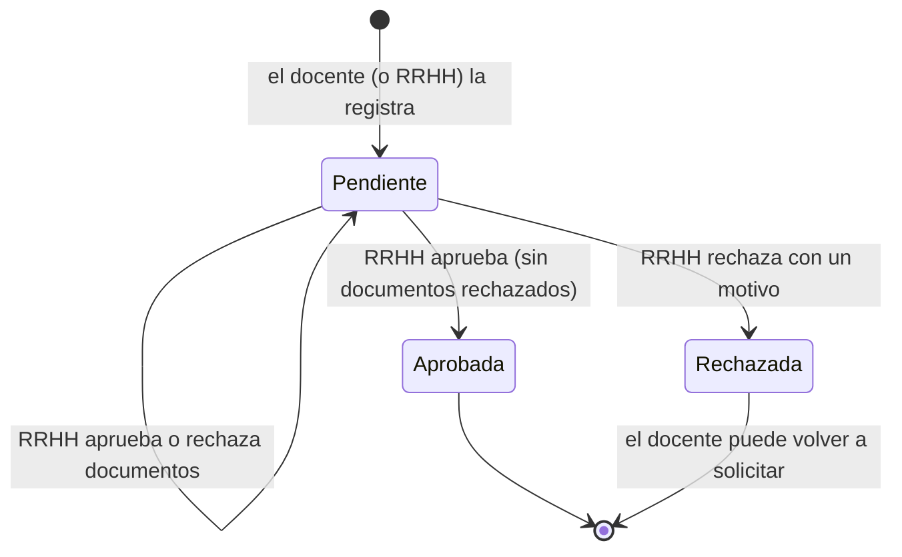

# Roles y flujo de aprobación

Todos los usuarios entran por el mismo login con su correo institucional. El rol guardado en `DITIC.dbo.Usuarios.Rol` decide qué secciones ve en el frontend y qué endpoints acepta la API.

## Roles del sistema

> No confundir con los **roles del escalafón** (Auxiliar 1 … Principal 3), que son las categorías de la carrera docente.

| Acción | Docente | RRHH | Administrador |
|--------|:-------:|:----:|:-------------:|
| Ver el escalafón (catálogo de roles) | ✔ | ✔ | ✔ |
| Ver **su propio** expediente y dictamen | ✔ | ✔ | ✔ |
| Consultar el expediente de **cualquier** cédula | | ✔ | ✔ |
| Solicitar su propia promoción | ✔ | | |
| Registrar una solicitud para cualquier docente | | ✔ | ✔ |
| Ver sus solicitudes | ✔ | | |
| Ver todas las solicitudes (bandeja) | | ✔ | ✔ |
| Aprobar o rechazar documentos | | ✔ | ✔ |
| Aprobar o rechazar solicitudes | | ✔ | ✔ |
| Crear, editar, activar o desactivar usuarios y restablecer contraseñas | | | ✔ |

Un docente necesita una cédula asociada a su usuario para ver su expediente. La API lee la cédula del token (`claim "cedula"`) y responde **403** si se pide otra.

### Secciones del frontend

| Rol | Al iniciar sesión llega a | Secciones |
|-----|---------------------------|-----------|
| Docente | Mi expediente | Mi expediente, Mis solicitudes |
| RRHH | Solicitudes (por revisar) | Solicitudes, Consultar docente |
| Administrador | Solicitudes (por revisar) | Solicitudes, Consultar docente, Usuarios |

Si alguien escribe a mano una ruta que su rol no tiene, el frontend lo devuelve a su primera sección. La API vuelve a comprobar los permisos en cada petición.

## Ciclo de vida de una solicitud

1. **Solicitud.** Desde *Mi expediente*, el docente revisa el dictamen automático y pulsa *Solicitar promoción*. La API toma el rol actual de RRHH y el siguiente rol del catálogo, y guarda la solicitud como `Pendiente`.
2. **Revisión de documentos.** En la bandeja, RRHH abre la solicitud y revisa cada documento del expediente:

   | Tipo (`TipoDocumento`) | Origen | Pestaña del frontend |
   |------------------------|--------|----------------------|
   | `TiempoRol` | RRHH.TiempoRol (acción de personal) | Otros méritos |
   | `Obra` | DIDE.Obras | Obras |
   | `Evaluacion` | DEaDV.EvaluacionesDocentes | Evaluaciones |
   | `Investigacion` | DIDE.Investigaciones | Investigaciones |
   | `Curso` | DEaDV.CursosCapacitacion | Cursos |

   Cada documento queda `Aprobado` o `Rechazado`. Una revisión se puede cambiar mientras la solicitud siga pendiente.
3. **Resolución.** RRHH aprueba o rechaza la solicitud con una observación para el docente.
4. **Seguimiento.** El docente ve en *Mis solicitudes* el estado, quién resolvió, la observación y el motivo de cada documento rechazado.

## Reglas

| Regla | Respuesta de la API |
|-------|---------------------|
| Solo una solicitud **pendiente** por cédula (también la garantiza un índice único filtrado en la base) | 409 |
| No se puede volver a pedir una promoción ya **aprobada** | 409 |
| No se puede solicitar desde el último rol (Principal 3) | 400 |
| La cédula debe existir en RRHH y su rol debe estar en el catálogo | 404 / 400 |
| Rechazar un documento exige un motivo | 400 |
| Rechazar una solicitud exige una observación | 400 |
| No se puede aprobar una solicitud con documentos rechazados | 409 |
| Una solicitud resuelta no admite más cambios (si dos revisores resuelven a la vez, gana el primero) | 409 |
| El administrador no puede desactivarse ni quitarse su propio rol | 400 |

## Lo que la aprobación **no** hace

RRHH es una base de otra dirección y la API solo la lee. Aprobar una promoción **no cambia** el rol del docente en `RRHH.TiempoRol`: RRHH debe registrarlo en su propio sistema. Mientras tanto, el expediente muestra el rol anterior y la API impide pedir otra vez la misma promoción.
